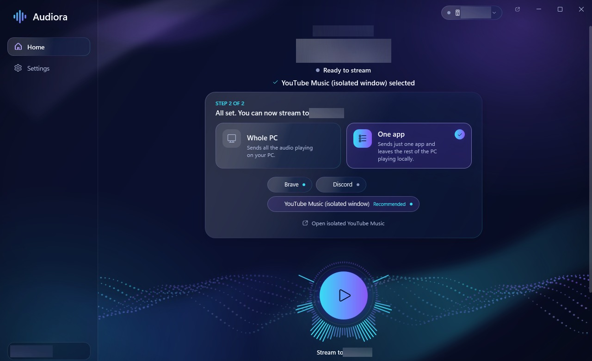
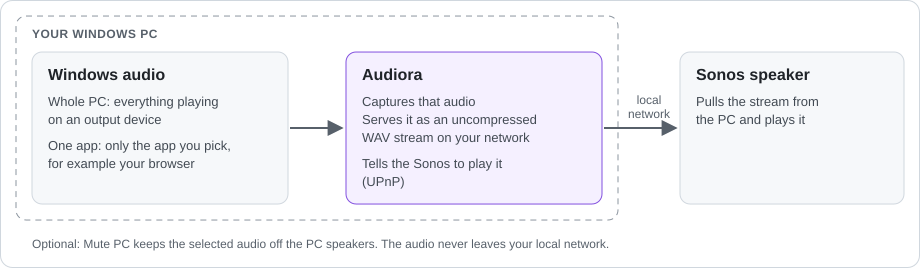
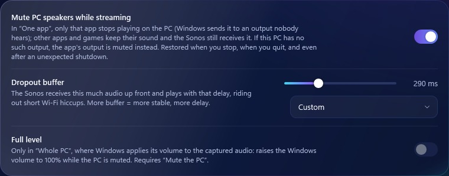

# Audiora

[](https://github.com/dextry1972-maker/Audiora/actions/workflows/ci.yml)

**Play your Windows PC’s audio on a Sonos speaker over Wi-Fi: everything the PC plays, or just one app such as your browser.** No Bluetooth, no cables and no Sonos app needed.

> **Beta for Windows 10/11 (64-bit).** [Download the latest release](https://github.com/dextry1972-maker/Audiora/releases). The app is not digitally signed, so Windows may show a security warning the first time. Please report bugs in [Issues](https://github.com/dextry1972-maker/Audiora/issues).



## Why use it

- **Whole PC or one app.** Send everything you hear on the PC, or pick a single app and leave the rest playing on the PC.
- **Browser audio on your Sonos.** Whatever plays in your browser (music, videos, web radio) comes out of the Sonos over Wi-Fi, with no Bluetooth pairing or cables.
- **No double audio.** With **Mute PC**, the Sonos plays without the same audio also coming out of the PC speakers. In “One app” mode only that app goes quiet on the PC; other apps and games keep their sound.
- **Recovers by itself.** If you close the app you are streaming and open it again (your browser, for example), Audiora picks it up and reconnects the Sonos automatically.
- **Adjustable dropout buffer.** Choose between less delay and more protection against Wi-Fi hiccups, from 0 to 1000 ms (see [below](#dropout-buffer)).
- **Local and private.** The audio stays on your local network, there is no account, and no data is collected.

## How it works



Audiora captures Windows audio: the whole output device with WASAPI loopback, or a single app with Windows per-process capture. It serves that audio from your PC as an uncompressed WAV stream on the local network and tells the Sonos (UPnP) to play it, and the Sonos then pulls the stream. Nothing is installed on the Sonos and no drivers are added to Windows. Technical details and measurements (in Spanish): [docs/INFORME-TECNICO.md](docs/INFORME-TECNICO.md).

## Install

1. Download `Audiora-Beta-Setup-win-x64.exe` from [Releases](https://github.com/dextry1972-maker/Audiora/releases) and run it. It installs for your user only, in `%LOCALAPPDATA%\Programs\SonosFlow`, without administrator rights, and adds Desktop and Start menu shortcuts. For a portable version, extract `Audiora-Beta-win-x64.zip` and open `Audiora\SonosFlow.exe` instead. .NET is included.
2. SmartScreen may say “Windows protected your PC”, because the beta is unsigned. Choose *More info → Run anyway*. You can first check the file against `SHA256SUMS.txt` from the release.
3. The first time you stream, Windows Firewall may ask for permission. Allow access **on private networks only**: the Sonos needs to reach the PC to download the audio.

**Requirements:** Windows 10 or 11, 64-bit. “One app” needs Windows 10 version 2004 or later. The Sonos must be on the same network as the PC, or connected to the PC’s Mobile hotspot.
**Uninstall:** Settings → Apps → Installed apps → Audiora. Your settings (`%APPDATA%\SonosFlow`) and logs (`%LOCALAPPDATA%\SonosFlow`) are kept.

## Use

1. Audiora finds the Sonos by itself. If you have more than one, pick it from the speaker menu at the top of the window.
2. Choose **Whole PC**, or **One app** and then the app.
3. Press the round button (**Stream to …**) to start, and press it again to stop.

- **Mute PC** is on by default. The PC’s sound is restored when you stop, when you quit, and even after an unexpected shutdown.
- **Full level** (“Whole PC” only) raises the Windows volume to 100% while the PC is muted, so you control the volume from the Sonos.
- You can control the Sonos volume, bass, treble and loudness from the app. By default, closing the window keeps Audiora in the system tray (you can change this in Settings).
- A **mini player** floats over other windows without taking the keyboard focus. Global shortcuts work anywhere, even inside a game:

| Shortcut | Action |
|---|---|
| Ctrl+Alt+↑ / Ctrl+Alt+↓ | Sonos volume ±5 |
| Ctrl+Alt+P | Pause / resume (or start streaming) |
| Ctrl+Alt+O | Show / hide the mini player |

**Browsers and single tabs:** Chrome, Edge and Brave play **all their tabs** from one process, so Audiora can send a browser but not just one of its tabs. For YouTube Music, **Open isolated YouTube Music** opens it in its own window (a separate process). That window appears as “YouTube Music (isolated window)” and can be streamed on its own. The first time, sign in in that window.

**Languages:** 12 languages, including Arabic (right to left). Change the language in Settings at any time without stopping the stream. All translations except Spanish are machine-made ([docs/LOCALIZATION.md](docs/LOCALIZATION.md)).

## Dropout buffer



The Sonos plays live, so a short Wi-Fi pause can be heard as a dropout. In **Settings → Audio → Dropout buffer**, Audiora gives the Sonos that much audio up front when it connects, and the Sonos plays that far behind. That lets it ride out network pauses shorter than the buffer.

- Drag the slider from **0 to 1000 ms** in 10 ms steps, or pick a preset (no buffer, 100 ms, 300 ms or 1 s). The default is **1 s**, and the setting applies the next time you start streaming.
- **Lower** reduces the delay Audiora adds on purpose, but makes dropouts more likely on a busy or weak Wi-Fi. **Higher** is steadier but adds delay.
- **0 ms is not zero latency:** capture and processing, the network and the Sonos’s own playback buffer still add some delay.

## Limitations

- **Beta and unsigned.** Expect bugs, and expect a SmartScreen warning when you install.
- **Single browser tabs can’t be selected,** only the whole browser (see [Use](#use)). Windows system sounds can’t be captured on their own either.
- **Your network and Sonos matter.** How it sounds, and how often it drops out, depends on your Wi-Fi and on the Sonos. So far it has only been tested with a Sonos Five. With a Sonos group, choose the group’s main speaker.
- **Latency:** the Sonos always plays somewhat behind the PC. With the default settings, most of that delay is the **dropout buffer** (Settings → Audio), which you can set anywhere from 0 to 1000 ms in 10 ms steps (1 s by default). A smaller buffer reduces the delay Audiora adds on purpose, but makes audible dropouts more likely when the Wi-Fi pauses. Even at 0 ms the delay is not zero: capture and processing, the network and the Sonos’s own playback buffer still add some. The only figures available are estimates from the playback position the Sonos reports, with about ±1 s uncertainty: roughly 1.1–1.4 s with the default 1 s buffer and roughly 0.5 s with no buffer. The end-to-end delay has not been measured with a microphone (the attempts so far picked up no sound). Games and lip-synced video have not been tested at a low buffer, so try the setting and judge for yourself.

## Privacy and security

- Everything is local: the audio never leaves your network and no data is collected.
- The stream server listens only on the local network address and **rejects any connection that does not come from a detected Sonos**.
- No administrator rights. Audiora writes only to your user profile and to `HKCU` (start with Windows and the uninstall entry), and it does not change the firewall or the antivirus.

## Development

Requires the .NET 8 SDK.

```powershell
dotnet build SonosFlow.sln -c Release      # build
dotnet test SonosFlow.sln -c Release       # automated tests
.\build.ps1                                 # self-contained app + installer in artifacts\
```

**Continuous integration:** GitHub Actions builds every push to `main` and every pull request on Windows, runs the automated tests and builds the installer. The runners have no audio devices and no Sonos, so CI does **not** check real capture or playback. Those checks are still done by hand. See [docs/CI.md](docs/CI.md).

<details>
<summary>Project layout</summary>

| Folder | Contents |
|---|---|
| `src/SonosFlow.Core` | Capture (`Audio/`), HTTP server (`Net/`), Sonos control and discovery (`Sonos/`), streaming session with reconnection (`Streaming/`) |
| `src/SonosFlow.App` | WPF interface: theme, spectrum visualizer, tray, settings, uninstall |
| `src/SonosFlow.Setup` | Per-user installer (.NET Framework 4.8, included in Windows) |
| `src/SonosFlow.Backup`, `src/SonosFlow.BackupCli`, `sfbackup.cmd` | Source-code backups, verified with SHA-256 (guide in Spanish: [docs/COPIAS-DE-SEGURIDAD.md](docs/COPIAS-DE-SEGURIDAD.md)) |
| `tests/` | Automated tests (xUnit) |
| `tools/SonosFlow.CaptureCheck` | Checks that per-app capture is isolated (test tones on an output nobody hears) |
| `poc/` | Console prototype used to validate streaming and take measurements |
| `docs/` | Technical notes, release notes and the images used here |

</details>

Formerly “Sonos Flow”: the technical names (`SonosFlow.*` projects, `SonosFlow.exe`, data folders) are unchanged. Licenses: Audiora is MIT ([LICENSE](LICENSE)) and uses NAudio (MIT). Personal project, not affiliated with or endorsed by Sonos, Inc.
