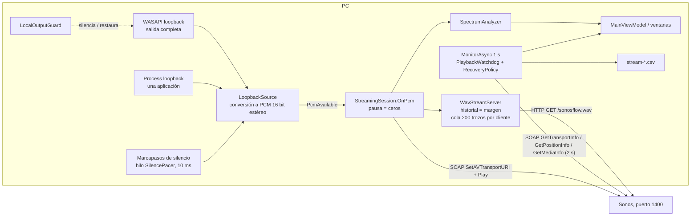

# Audiora — Arquitectura

Estado: rama `mejoras/hitos-arquitectura` (28/10/2026, commit `a7e2b36`). Nombre visible **Audiora**; los identificadores técnicos siguen siendo `SonosFlow` (namespaces, `SonosFlow.exe`, carpetas de datos, claves HKCU, mutex). Detalle por área: [AUDIO_PIPELINE.md](AUDIO_PIPELINE.md), [NETWORKING.md](NETWORKING.md), [TESTING.md](TESTING.md).

## 1. Proyectos

Verificado en los `.csproj` y en `SonosFlow.sln`.

| Proyecto | Tipo / destino | Responsabilidad | Depende de |
|---|---|---|---|
| `src/SonosFlow.Core` | Biblioteca, `net8.0` | Captura, servidor HTTP, control y descubrimiento Sonos, sesión de streaming | NAudio.Wasapi 2.2.1 (MIT) |
| `src/SonosFlow.App` | WinExe, `net8.0-windows`, WPF (+ WinForms solo para la bandeja); ensamblado `SonosFlow` → `SonosFlow.exe` | Interfaz, ajustes, registros, bandeja, mini reproductor, atajos, autotest | Core, Backup |
| `src/SonosFlow.Setup` | WinExe, `net48`, WinForms → `SonosFlow-Setup.exe` | Instalador por usuario; incrusta `artifacts\payload.zip` como recurso | ninguno (solo BCL) |
| `src/SonosFlow.Backup` | Biblioteca, `net8.0` | Copias del código fuente con SHA-256, plan y restauración | ninguno |
| `src/SonosFlow.BackupCli` | Exe, `net8.0` (+ `sfbackup.cmd`, que lo lanza con `dotnet run`) | Línea de comandos de copias | Backup |
| `tests/SonosFlow.Core.Tests` | xUnit 2.5.3, `net8.0-windows` | Servidor WAV, detector de atascos, vigilante de reproducción y política de reintentos | Core |
| `tests/SonosFlow.Backup.Tests` | xUnit 2.5.3, `net8.0` | Motor de copias | Backup |
| `tools/SonosFlow.CaptureCheck` | Exe, `net8.0-windows` | Comprobaciones de captura sin sonido audible, prueba de resistencia | Core |
| `poc/SonosFlow.Poc` | Exe, `net8.0` | Prueba de concepto por consola (fase 1). **No está en `SonosFlow.sln`**: copia propia del código, no se compila con la solución | NAudio.Wasapi 2.2.1 |
| `tools/make_icon.py` | Python sin dependencias | Genera el icono | — |

```mermaid
graph LR
  App[SonosFlow.App] --> Core[SonosFlow.Core]
  App --> Backup[SonosFlow.Backup]
  BackupCli[SonosFlow.BackupCli] --> Backup
  CoreTests[Core.Tests] --> Core
  BackupTests[Backup.Tests] --> Backup
  CaptureCheck[tools/CaptureCheck] --> Core
  Setup[SonosFlow.Setup net48] -. payload.zip .-> App
```

## 2. Capas de `SonosFlow.Core`

| Carpeta | Tipos | Qué hace |
|---|---|---|
| `Audio/` | `LoopbackSource`, `ProcessLoopbackCapture`, `AudioApps`, `AudioDevices`, `LocalOutputGuard`, `SpectrumAnalyzer` | Captura de la salida completa (WASAPI loopback) o de un proceso (process loopback), conversión a PCM 16 bit estéreo, relleno de silencio, lista de apps con audio, silencio local con recuperación tras cierre inesperado, espectro |
| `Net/` | `WavStreamServer` | HTTP/1.1 sobre `TcpListener` en la IP LAN; WAV «infinito»; lista blanca; margen anti-cortes; métrica de cola |
| `Sonos/` | `SonosDiscovery`, `SonosDevice`, `SonosClient`, `SonosSoapException` | SSDP M-SEARCH, descripción del dispositivo, SOAP UPnP (AVTransport, RenderingControl) en el puerto 1400 |
| `Streaming/` | `StreamingSession`, `CaptureSpec`, `StreamOptions`, `StreamStats`, `StallTracker`, `PlaybackWatchdog`, `RecoveryPolicy` | Orquesta una transmisión: arranque, cambio de fuente y pausa sin reconectar, vigilancia cada segundo, CSV, atascos. `PlaybackWatchdog` decide si el Sonos reproduce de verdad (`Healthy`/`NotPlaying`/`NotConsuming`/`Frozen`) y `RecoveryPolicy` acota los reintentos; ambos son lógica pura con reloj inyectado, probada sin altavoz |

Estados de la sesión (`SessionState`): `Starting`, `Streaming`, `Recovering`, `Stopped`, `Failed` y `Released` (el usuario eligió otra fuente, pausó o detuvo desde la app de Sonos; la sesión termina a propósito, sin enviar `Stop` y sin reintentos). La limpieza (`TearDownAsync`) va por pasos: cada uno se ejecuta aunque falle el anterior. Detalle: [NETWORKING.md](NETWORKING.md) §7.

Core no conoce WPF: publica eventos (`StatsUpdated`, `StateChanged`, `SourceChanged`, `Diagnostic`) y la App los lleva al hilo de interfaz.

## 3. Capas de `SonosFlow.App`

| Parte | Archivos | Qué hace |
|---|---|---|
| Ventanas | `MainWindow`, `MiniPlayerWindow`, `VolumeHudWindow`, `App.xaml.cs` | Ventana principal (páginas «home» y «settings»), cápsula flotante, indicador breve de los atajos (HUD), arranque, argumentos, instancia única, salida ordenada |
| `ViewModels/` | `MainViewModel` (sesión, altavoz, volumen/ecualizador, estadísticas) + `MainViewModel.Sources.cs` (fuente, pausa, estado del mini) + `MainViewModel.Extras.cs` (atajos, petición del HUD, temporizador de apagado, indicador de red) + `MainViewModel.Startup.cs` (espera de arranque acotada a 5 min); `SpeakerItem`, `AppSourceItem`, `BackupViewModel` | **Un único `MainViewModel`** compartido por la ventana, el mini reproductor, la bandeja, los atajos y el HUD: una sola sesión y una sola conexión con el Sonos |
| `Infrastructure/` | `AppPaths`, `AppSettings`, `AppLog`, `TrayIcon`, `GlobalHotkeys`, `WindowsIntegration`, `SelfTest`, `Mvvm`, `Converters`, `IconCache` | Rutas, ajustes JSON, registro de eventos, bandeja, `RegisterHotKey`, HKCU (inicio con Windows, desinstalar), autotest con el Sonos |
| `Controls/` | `SpectrumVisualizer`, `LevelRing` | Dibujo del espectro (`CompositionTarget.Rendering`) y anillo de nivel |

## 4. Flujo de datos



El audio nunca se «empuja»: el Sonos descarga el stream que el PC sirve ([NETWORKING.md](NETWORKING.md)).

## 5. Modelo de hilos

| Hilo | Qué corre |
|---|---|
| Interfaz (STA, `Dispatcher`) | Ventanas, `MainViewModel`, `DispatcherTimer` (sondeo del Sonos 3 s, lista de apps 2,5 s, antirrebote de volumen 120 ms y de ecualizador 150 ms, temporizador de apagado 1 s, nivel del mini 66 ms, ocultación del HUD 1,6 s), bandeja WinForms, ventana de mensajes de los atajos, bucle de espera de arranque (`NetworkChange.NetworkAddressChanged` se lleva a este hilo con `BeginInvoke`) |
| Grupo de hilos (MTA) | `StreamingSession.StartAsync` / `SwitchSourceAsync` / `StopAsync` se ejecutan con `Task.Run`: los objetos Core Audio de la sesión se crean y liberan solo ahí (comentario del constructor de `StreamingSession`). También `AudioApps.List`, el bucle `MonitorAsync`, el bucle de aceptación y un bucle de envío por cliente del servidor |
| Captura | Hilo propio de `WasapiLoopbackCapture` (NAudio) o `ProcessLoopback-<pid>` (prioridad AboveNormal) |
| `SilencePacer` | Hilo AboveNormal; despierta cada 10 ms |

`OnPcm` (escritura al servidor, espectro, pico) se ejecuta en el hilo de captura o del marcapasos, serializado por `_emitLock` de `LoopbackSource`. `StatsUpdated`, `StateChanged` y `SourceChanged` llegan a la interfaz con `Dispatcher.BeginInvoke`; `Diagnostic` escribe directamente en `AppLog` (protegido con `lock`). El hilo de interfaz también usa Core Audio para enumeraciones de solo lectura (`AudioDevices.ListOutputs`) y para `LocalOutputGuard.RecoverPending` al arrancar.

## 6. Rutas y datos (`Infrastructure/AppPaths.cs`)

| Dato | Ruta |
|---|---|
| Ajustes | `%APPDATA%\SonosFlow\settings.json` (no se guardan en modos de prueba: `AppSettings.PersistenceEnabled = false`) |
| Estado de silencio pendiente | `%LOCALAPPDATA%\SonosFlow\output-guard.json` (existe solo mientras el PC está silenciado por Audiora) |
| Registros | `%LOCALAPPDATA%\SonosFlow\logs\`: `app-events.log`, `errors.log`, `stream-AAAAMMDD-HHMMSS.csv` |
| Perfil de YouTube Music aislado | `%LOCALAPPDATA%\SonosFlow\YouTubeMusicProfile` |
| Instalación | `%LOCALAPPDATA%\Programs\SonosFlow` |
| Copias del código | `%USERPROFILE%\SonosFlow-Backups` (fuera del proyecto y de OneDrive) |
| Registro de Windows | `HKCU\...\Run` valor `SonosFlow` = `"<exe>" --minimized`; `HKCU\...\Uninstall\SonosFlow`. Nunca HKLM |

Ajustes por defecto relevantes (`AppSettings.cs`): puerto 8780, «Silenciar el PC» activado, «Nivel completo» desactivado, margen anti-cortes 1000 ms, atajos globales activados, cerrar = bandeja.

## 7. Ciclo de vida de la aplicación

- **Instancia única:** mutex `Local\SonosFlow.SingleInstance`. Una segunda copia activa el evento `Local\SonosFlow.Show` (la primera muestra su ventana) y sale. Los modos de prueba (`--screenshot`, `--screenshot-mini`, `--screenshot-hud`, `--selftest-session`) **no** toman el mutex, no registran la bandeja ni los atajos, no guardan ajustes y **nunca reanudan** una transmisión desde los ajustes guardados (`InitializeAsync(allowResume: false)`; solo `--autostart` inicia). `--screenshot-hud` ni siquiera inicializa (sin descubrimiento ni Sonos).
- **Arranque:** `RecoverPending` deshace un silencio que quedara de un cierre inesperado → descubrimiento SSDP (3 s) → elige el último altavoz usado, si no uno «Five», si no el primero → con `--autostart` o «reanudar al iniciar» entra en la **espera de arranque** (`MainViewModel.Startup.cs`): al iniciar Windows la zona Wi-Fi y el Sonos pueden tardar, así que reintenta descubrir y transmitir a los 2, 3, 5, 8, 13, 20 y luego cada 30 s, **5 min como máximo**; un cambio de red adelanta el intento (con 2 s de margen). Solo sigue reintentando con fallos recuperables (red, plazo, puerto ocupado, error SOAP del Sonos salvo el 800 —p. ej. un HTTP 500 mientras arranca—); un fallo definitivo (altavoz agrupado, app cerrada…) se muestra y termina la espera. Cualquier acción manual (transmitir, buscar, elegir altavoz) o salir la cancela, y la elección del usuario se respeta.
- **Detener durante «Conectando…»:** cada inicio es un `PendingStart` (sesión, tarea de inicio y `CancellationTokenSource` que se pasa a `StreamingSession.StartAsync`). `StopAsync` cancela el token y `AbortStartAsync` espera a que el inicio termine o falle y lo deshace, sin dejar una sesión huérfana (PC silenciado o puerto ocupado). Un segundo `Stop` mientras tanto (bandeja + salir) espera esa misma limpieza.
- **Sesión liberada (`Released`):** la App se detiene sin mostrarlo como error, enseña el motivo y no reanudará al abrir.
- **Bandeja** (`TrayIcon`): estado, abrir ventana, mostrar/ocultar mini, iniciar/detener, salir. Clic izquierdo abre la ventana.
- **Mini reproductor:** ventana WPF en capas (`AllowsTransparency`), `WS_EX_NOACTIVATE | WS_EX_TOOLWINDOW`, `ShowActivated=False`, sin botón en la barra de tareas; Alt+F4 la oculta. Se atenúa a opacidad 0,72 tras 2,5 s sin ratón. Ocultarla no toca la sesión.
- **Atajos globales** (`GlobalHotkeys`): `RegisterHotKey` en una ventana `HWND_MESSAGE`; Ctrl+Alt+↑/↓ (volumen ±5, con repetición), Ctrl+Alt+P (pausa/inicio), Ctrl+Alt+O (mini). Informa de los que otro programa ya usa.
- **HUD** (`VolumeHudWindow`): `MainViewModel.HandleHotkey` lanza `HudRequested` (icono, texto, barra 0–1 opcional) para volumen, pausa/reanudar, «Conectando…» o «Sonos sin conexión». Ventana en capas, `Topmost`, `WS_EX_NOACTIVATE | WS_EX_TOOLWINDOW | WS_EX_TRANSPARENT` (no toma el foco ni recibe clics); abajo en el centro del monitor donde está el ratón, 90 px sobre el borde; se oculta a los 1,6 s con fundido de 250 ms. Se ve sobre juegos en ventana o sin bordes, no sobre pantalla completa exclusiva.
- **Temporizador de apagado** (`MainViewModel.Extras.cs`): 30/60/90 min, solo con la transmisión activa (`Streaming` o `Recovering`, no mientras conecta); no se guarda y se cancela al detener.
- Título/artista: `Infrastructure/MediaSessionWatcher.cs` lee las sesiones multimedia de Windows (GSMTC, solo lectura; eventos en hilos MTA llevados al dispatcher, antirrebote 300 ms, resolución fuera del hilo de UI) y `ViewModels/MainViewModel.Media.cs` expone `NowPlayingTitle/Artist`. Elige la sesión por AUMID exacto de las ventanas del proceso capturado, luego por ejecutable (Brave/Chrome/MSEdge/Spotify; YouTube Music aislado exige `music.youtube.com`); en «Todo el PC» usa la sesión actual de Windows; en modo aplicación sin coincidencia no muestra nada. Requiere el TFM `net8.0-windows10.0.19041.0` de la App (+~24 MB publicados, instalador +~6 MB).
- **Cerrar ventana:** según Ajustes → bandeja, mini reproductor o salir. `ShutdownMode=OnExplicitShutdown`; `QuitAsync` detiene la sesión (restaura el PC) antes de `Shutdown()`, también al cerrar la sesión de Windows.
- **Errores no controlados del Dispatcher:** se anotan en `errors.log` y se muestra un aviso; la app sigue.

Argumentos: `--minimized`, `--autostart`, `--exit-after N`, `--uninstall`, `--screenshot FILE`, `--page settings`, `--size WxH`, `--delay MS`, `--screenshot-mini FILE` (+ `--expand`), `--screenshot-hud FILE`, `--selftest-session PID --selftest-out FILE`. Uso en pruebas: [TESTING.md](TESTING.md).

## 8. Instalador y desinstalación

- `build.ps1`: borra y recrea `artifacts\`; `dotnet publish` de la App autocontenida `win-x64` (sin ReadyToRun, sin símbolos) → `artifacts\app` → `payload.zip` → compila `SonosFlow.Setup` con `-p:PayloadZip=…` → `artifacts\SonosFlow-Setup.exe`. No instala nada en el sistema.
- `SonosFlow-Setup.exe` (sin administrador, `asInvoker`): opciones `/quiet`, `/dir RUTA`, `/noshortcuts`, `/noregistry`, `/nolaunch`. Se niega si falta el paquete, si hay un proceso `SonosFlow` abierto o si la carpeta existe y no contiene `SonosFlow.exe`. Borra la instalación anterior, extrae con comprobación de rutas (zip-slip), crea `Audiora.lnk` en Escritorio y Menú Inicio (elimina `Sonos Flow.lnk` solo si apunta a este exe) y registra la entrada de desinstalación en HKCU. En `/quiet` los errores van a `%TEMP%\SonosFlow-Setup.log`.
- Desinstalar: `SonosFlow.exe --uninstall` quita el valor Run, la clave Uninstall y los accesos directos que apuntan a este exe; si es la copia instalada, un `cmd` borra la carpeta 2 s después de salir. Ajustes, registros y copias se conservan.
